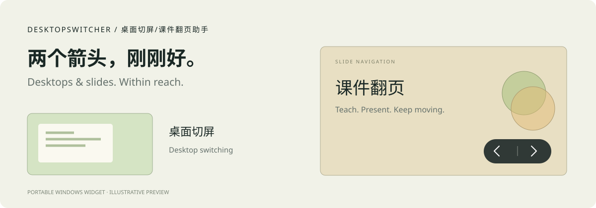

# DesktopSwitcher · 桌面切屏/课件翻页助手

**Two arrows. A smoother way to switch desktops and present slides.** A portable Windows widget built with C#, WPF and .NET Framework 4.8.

[简体中文](README.md) · [Website](https://shiyu429.github.io/Desktop-Slide-Assistant/) · [Latest release](https://github.com/shiyu429/Desktop-Slide-Assistant/releases/latest)



## Choose how you work

| Feature | What it does | Where it helps |
| --- | --- | --- |
| **Desktop switching** | Move between adjacent Windows virtual desktops. At the last desktop, the right arrow creates and opens a new one. Left at the first desktop stays put. | Separate lesson preparation from teaching, organize workspaces, and manage multiple tasks. |
| **Slide navigation** | The widget appears only when a foreground PowerPoint or WPS window is presenting full screen. Arrows send native Left / Right keys for slides and animation steps. It hides when the presentation is no longer active. | Interactive whiteboards, touch displays, classroom teaching, meetings and workshops. |
| **Automatic switching** | Switch virtual desktops normally. During a foreground full-screen PowerPoint or WPS slideshow, the arrows navigate slides; leaving the show restores desktop switching. | Teaching or presenting while frequently moving between slides and desktop apps. |

Choose a feature on first launch, then change it from the widget or tray menu. Slide navigation offers an optional start-at-login prompt in the same visual style; declining keeps the app usable.

## Small details that help

- Drag freely and keep your position. Optional edge hiding tucks the widget against the left or right screen edge and expands on hover. It is off by default in Slide navigation and Automatic switching.
- Both menus group Immersive appearance, Super topmost, and Edge auto-hide under More features. Immersive appearance keeps only black arrows and a divider, with full button hit areas. Super topmost raises the widget when another always-on-top app covers it. It does not override the Windows secure desktop or exclusive full-screen rendering.
- A spotlight guide points to the slide controls. Dismiss it by clicking elsewhere or choose “Don't remind me again”.
- The widget does not deliberately take keyboard focus when clicked. Use the tray to change features or quit; a single instance runs at a time.

## Run

Download the portable ZIP from [Releases](https://github.com/shiyu429/Desktop-Slide-Assistant/releases/latest), extract it, keep `DesktopSwitcher.exe.config` next to the EXE, and launch `DesktopSwitcher.exe`. Choose Desktop switching, Slide navigation, or Automatic switching. When no slideshow is active, Slide navigation remains in the tray. Reset position and Start at login are also available in the tray menu.

Requires Windows 10 / 11 virtual desktops and .NET Framework 4.8. Slideshow recognition can vary between Office / WPS versions. The desktop registry format is not a stable public interface: when the app cannot reliably identify the current desktop, it stops automatic desktop creation and reports the issue. The current application UI is Chinese; this website and README are bilingual.

## Build and verify

Uses the locally installed Microsoft .NET Framework compiler, with no dependency downloads.

```powershell
.\Build.ps1 -OutputDirectory releases\1.4.5\portable
.\build\qa\Tests.exe
node .\tests\WebsiteCheck.mjs
.\tests\FullProductCheck.ps1 -Version 1.4.5
.\Package.ps1
```

`src/` contains the app, `tests/` contains checks and fixtures, and `docs/` contains the static bilingual website. Local `build/`, `releases/` and `archive/` are excluded from Git. GitHub Pages serves `/docs` from `main`; no front-end build is needed.
