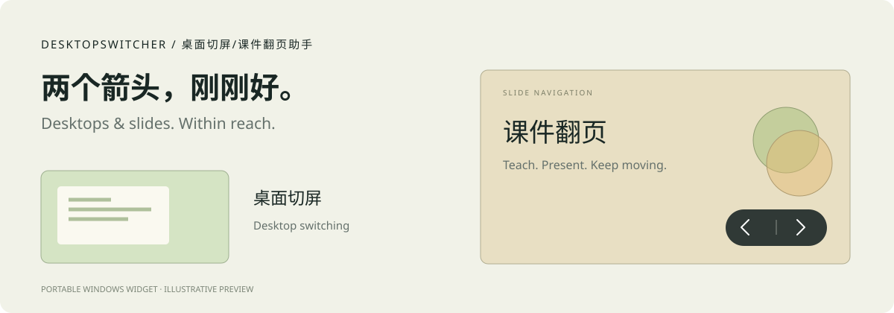

# 桌面切屏/课件翻页助手 · DesktopSwitcher

**两个箭头，让桌面切换和课件翻页更顺手。** Windows 便携悬浮工具，使用 C# / WPF / .NET Framework 4.8。

[English](README.en.md) · [项目主页](https://shiyu429.github.io/Desktop-Slide-Assistant/) · [下载最新版](https://github.com/shiyu429/Desktop-Slide-Assistant/releases/latest)



## 三种模式，按需选择

| 功能 | 操作方式 | 适用场景 |
| --- | --- | --- |
| **桌面切屏** | 左右箭头切换相邻虚拟桌面，最右侧再点击会新建并进入；第一屏向左保持原位。 | 备课与授课资料分开、办公多任务、工作与个人窗口分区。 |
| **课件翻页** | 仅当前台 PowerPoint / WPS 全屏放映时显示。左右箭头发送原生方向键，逐步播放课件及动画；结束放映后隐藏。 | 课堂电子白板、触屏教学、会议演示、培训分享。 |
| **自动切换** | 平时切换虚拟桌面，当前台 PowerPoint / WPS 全屏放映时自动改为翻页；离开放映后恢复切屏。 | 授课或会议中经常在课件和桌面之间来回切换。 |

首次启动选择常用功能，之后从右键或托盘菜单切换。选择课件翻页时，以配套的卡片弹窗询问是否允许开机启动；可选择“暂不开启”。

## 随手操作，安静陪伴

- 自由拖动，记住位置；接触屏幕左右边缘后可自动收起，鼠标碰到边缘展开。课件翻页和自动切换默认关闭贴边隐藏。
- 在右键菜单的“更多功能”中可开启透明沉浸、超级置顶或贴边自动隐藏。透明沉浸只显示黑色左右箭头与中间竖线，保留完整按钮操作区域。超级置顶会在其他应用的置顶窗口覆盖悬浮按钮时重新抬高按钮，Windows 安全界面和独占全屏不受此设置控制。
- 放映时显示“点击此处翻页”的聚光灯引导，点其他区域关闭本次提示，或选择“不再提醒”。
- 点击悬浮按钮时不主动抢走应用焦点；单实例运行，托盘中可退出或切换功能。

## 开始使用

1. 从 [Releases](https://github.com/shiyu429/Desktop-Slide-Assistant/releases/latest) 下载便携 ZIP，解压到固定文件夹。
2. 保留 `DesktopSwitcher.exe.config`，双击 `DesktopSwitcher.exe`。
3. 选择“桌面切屏”“课件翻页”或“自动切换”。未放映时，课件翻页只保留托盘入口。恢复右下角位置和开机启动也在托盘菜单中。

需要 Windows 10 / 11 的虚拟桌面功能及 .NET Framework 4.8。不同 Office / WPS 版本的放映识别可能不同。虚拟桌面登记格式变化或无法可靠判断位置时，会停止自动新建并提示。

## 构建

使用本机已有的微软 .NET Framework 编译器，不下载依赖。在项目目录运行 PowerShell：

```powershell
.\Build.ps1 -OutputDirectory releases\1.4.5\portable
.\build\qa\Tests.exe
node .\tests\WebsiteCheck.mjs
.\Package.ps1
```

真实产品退出回归（使用隔离配置，不改普通设置）：

```powershell
.\tests\FullProductCheck.ps1 -Version 1.4.5
```

## 项目结构

| 目录 | 内容 |
| --- | --- |
| `src/` | 应用源码、图标、清单与运行配置 |
| `tests/` | 功能检查、真实进程退出检查、测试课件 |
| `docs/` | 中英双语静态主页 |
| `Build.ps1` / `Package.ps1` | 构建及打包 |
| `build/` / `releases/` / `archive/` | 本机构建、交付和历史归档，不提交到 Git |

网页使用纯 HTML / CSS / JavaScript，GitHub Pages 从 `main` 分支的 `/docs` 发布，无需前端依赖。
